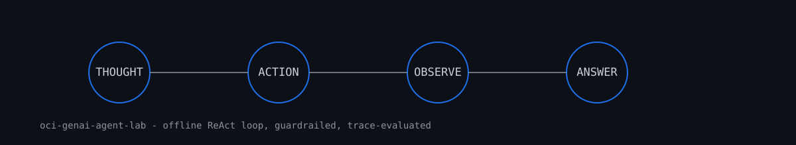

# oci-genai-agent-lab



An **offline** lab for the agent pattern behind OCI Generative AI agents: a
ReAct loop (Thought -> Action -> Observation) with tool guardrails and
golden-trace evaluation. A deterministic **scripted planner** stands in for
the LLM, so the whole loop runs locally and reproducibly - the parser,
guardrails, tools and evaluator are exercised exactly as they would be with
a real model behind them.

**Portfolio project. Not live-tested on OCI.** No OCI SDK, no network calls,
no live tenancy. All tool data is synthetic and fixed in `tools.py`. Swapping
`ScriptedPlanner` for a real OCI Generative AI client is left as future work
and would need an authorized tenancy.

## What it demonstrates

- **ReAct loop** (`agent.py`): parses `Thought:` / `Action: tool[arg]` /
  `Final Answer:` turns, executes mock tools, appends observations, stops on
  final answer, step cap, or guardrail.
- **Mock OCI tools** (`tools.py`): `list_instances`, `get_metrics`,
  `search_logs`, `get_budget` - read-only, synthetic data shaped like OCI
  Compute/Monitoring/Logging/Cost concepts.
- **Guardrails** (`guardrails.py`): tool allow-list, destructive-verb deny
  list (`terminate`, `delete`, ...), max-step cap, and PII/OCID redaction of
  observations and final answers.
- **Trace evaluation** (`evaluate.py` + `fixtures/golden.json`): runs golden
  tasks and gates on the exact action sequence, answer content and stop
  reason - the offline analogue of an agent eval harness.

## Run it

```bash
python -m pytest tests/ -q                 # test suite
PYTHONPATH=src python -m genai_agent_lab   # golden-trace eval, JSON summary
```

The CLI exits non-zero if any golden case regresses, which is wired into CI.

## Layout

```
src/genai_agent_lab/   agent loop, planner, tools, guardrails, trace, eval, CLI
fixtures/golden.json   golden tasks with expected actions and stop reasons
tests/                 parser, guardrail, agent-loop, evaluation and CLI tests
```

## Honest limits

- The planner is scripted, not a model: it demonstrates the loop mechanics
  and safety wiring, not emergent reasoning.
- Tool responses are fixed fixtures; nothing here measures performance
  against real OCI services.
- Guardrails are a teaching implementation, not a production policy engine.
